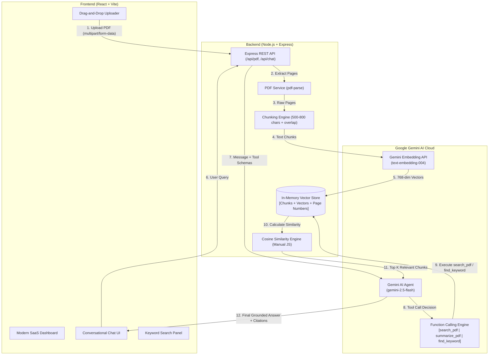

# AI PDF Research Assistant 📑🤖

> A modern, full-stack Generative AI application featuring a pure JavaScript Retrieval-Augmented Generation (RAG) pipeline, manual vector similarity search, and an autonomous AI Agent powered by Google Gemini native function calling.

[](https://nodejs.org/)
[](https://react.dev/)
[](https://www.npmjs.com/package/@google/genai)
[](LICENSE)

---

## Table of Contents

1. [Project Overview](#1-project-overview)
2. [Core Features](#2-core-features)
3. [Technology Stack](#3-technology-stack)
4. [Project Structure](#4-project-structure)
5. [Architecture Diagram](#5-architecture-diagram)
6. [GenAI & RAG Concepts Explained (Interview Ready)](#6-genai--rag-concepts-explained-interview-ready)
   - [What is RAG (Retrieval-Augmented Generation)?](#61-what-is-rag)
   - [What is Text Chunking?](#62-what-is-text-chunking)
   - [What are Vector Embeddings?](#63-what-are-vector-embeddings)
   - [What is Cosine Similarity?](#64-what-is-cosine-similarity)
   - [What is Semantic Search?](#65-what-is-semantic-search)
   - [What is an In-Memory Vector Store?](#66-what-is-an-in-memory-vector-store)
   - [What is Gemini Native Function Calling?](#67-what-is-gemini-native-function-calling)
   - [What is an AI Agent?](#68-what-is-an-ai-agent)
7. [The Three AI Tools](#7-the-three-ai-tools)
8. [Complete Request Flow](#8-complete-request-flow)
9. [Installation & Setup](#9-installation--setup)
10. [Environment Variables](#10-environment-variables)
11. [Running the Application](#11-running-the-application)
12. [Running Unit Tests](#12-running-unit-tests)
13. [Example Questions to Ask the Assistant](#13-example-questions-to-ask-the-assistant)
14. [Interview Preparation Guide](#14-interview-preparation-guide)

---

## 1. Project Overview

The **AI PDF Research Assistant** allows users to upload complex research papers, academic textbooks, business reports, or technical manuals, and interact with them intuitively through natural language.

Unlike simple chatbots that dump an entire document into an LLM prompt (which blows up token budgets, costs, and hallucination rates), this system implements an authentic, zero-dependency **RAG pipeline** entirely in **JavaScript**:
- It extracts text and page numbers page-by-page.
- It slices the document into overlapping chunks (500–800 characters) preserving sentence boundaries.
- It converts text chunks into 768-dimensional mathematical vectors using Google Gemini's `text-embedding-004` model.
- It indexes these vectors inside an in-memory vector store.
- When you ask a question, an **autonomous AI Agent** uses Gemini's native function calling to choose between semantic search, full document summarization, or exact keyword lookup.
- It retrieves the top matching chunks using manual cosine similarity, injects only those chunks into Gemini LLM (`gemini-2.5-flash`), and streams back a grounded, fact-checked response with page-level citations.

---

## 2. Core Features

- 📤 **Drag-and-Drop PDF Ingestion**: Handles PDFs up to 10 MB with client-side and server-side validation.
- ✂️ **Intelligent Text Chunking**: Splits text into 500–800 character chunks with 120-character sliding overlap and sentence boundary preservation.
- 📐 **Dense Vector Embeddings**: Embeds chunks using Google Gemini's official `@google/genai` SDK (`text-embedding-004`).
- 🧠 **Pure JavaScript Vector Store**: In-memory vector store with no heavyweight external databases (no Pinecone, ChromaDB, or Weaviate).
- 🎯 **Manual Cosine Similarity**: Pure mathematical implementation of dot products and Euclidean norms.
- 🤖 **Autonomous AI Agent**: Uses Gemini native function calling to dynamically choose tools (`search_pdf`, `summarize_pdf`, `find_keyword`) rather than hardcoded if-else keywords.
- 📑 **Page-Level Citations**: Highlights exact page numbers and similarity scores for every answer.
- 🔍 **Dedicated Keyword Search**: Direct string occurrence analysis with contextual window snippets.
- 📊 **Executive Document Summarizer**: Map-reduce summarization capable of handling short and long documents.
- 💻 **Modern SaaS UI**: Polished, responsive dark-mode dashboard built with React and Vite.

---

## 3. Technology Stack

### Frontend
- **Framework**: React 18
- **Build Tool**: Vite 6
- **HTTP Client**: Axios
- **Icons**: Lucide React
- **Styling**: Vanilla CSS3 (Custom SaaS Design System, CSS Variables, Responsive Grid)

### Backend
- **Runtime**: Node.js (ES Modules `"type": "module"`)
- **Server Framework**: Express.js
- **File Uploads**: Multer (In-memory buffer storage)
- **PDF Extraction**: `pdf-parse` (Page-by-page text stream renderer)
- **Environment Management**: `dotenv`
- **Testing**: Node.js native test runner (`node:test`, `node:assert`)

### Generative AI
- **Official SDK**: `@google/genai` (v2.32+)
- **LLM Model**: `gemini-2.5-flash` (Configurable via `GEMINI_MODEL`)
- **Embedding Model**: `text-embedding-004` (Configurable via `GEMINI_EMBEDDING_MODEL`)
- **Tool Calling**: Gemini Native `functionDeclarations` and `functionResponse`

---

## 4. Project Structure

```
AIproject/
├── backend/
│   ├── src/
│   │   ├── config/
│   │   │   └── gemini.js           # Gemini SDK initialization & configuration
│   │   ├── controllers/
│   │   │   └── pdfController.js    # Express route controllers & input validation
│   │   ├── routes/
│   │   │   └── pdfRoutes.js        # API endpoint definitions & Multer upload middleware
│   │   ├── services/
│   │   │   ├── pdfService.js       # PDF text extraction & page-by-page parsing
│   │   │   ├── embeddingService.js # Gemini embedding generation & batching
│   │   │   ├── vectorStore.js      # In-memory vector store & keyword indexer
│   │   │   └── ragService.js       # Complete RAG pipeline orchestration
│   │   ├── tools/
│   │   │   ├── searchPdf.js        # Tool 1: Semantic vector retrieval
│   │   │   ├── summarizePdf.js     # Tool 2: Single-pass & Map-reduce document summary
│   │   │   └── findKeyword.js      # Tool 3: Substring search with context windows
│   │   ├── agents/
│   │   │   └── pdfAgent.js         # Native Gemini function-calling autonomous agent loop
│   │   ├── utils/
│   │   │   ├── chunkText.js        # Text chunking algorithm with overlap & page metadata
│   │   │   └── cosineSimilarity.js # Manual cosine similarity formula implementation
│   │   ├── tests/
│   │   │   ├── chunkText.test.js
│   │   │   ├── cosineSimilarity.test.js
│   │   │   ├── vectorStore.test.js
│   │   │   ├── findKeyword.test.js
│   │   │   ├── pdfService.test.js
│   │   │   └── routes.test.js
│   │   └── server.js               # Express server entry point & error handlers
│   ├── uploads/                    # Temporary upload staging (.gitkeep)
│   ├── .env.example                # Example environment variables template
│   └── package.json                # Backend dependencies & scripts
│
├── frontend/
│   ├── src/
│   │   ├── components/
│   │   │   ├── Header.jsx          # Header with API status & active document badge
│   │   │   ├── UploadSection.jsx   # Drag-and-drop PDF uploader with progress state
│   │   │   ├── DocumentInfo.jsx    # Active document metadata card & action buttons
│   │   │   ├── KeywordSearch.jsx   # Dedicated keyword lookup panel
│   │   │   └── ChatInterface.jsx   # Chat window, agent reasoning badges, citations
│   │   ├── services/
│   │   │   └── api.js              # Axios API methods
│   │   ├── App.jsx                 # Central dashboard layout & state management
│   │   ├── main.jsx                # React root mount
│   │   └── index.css               # SaaS dark-mode styling
│   ├── index.html
│   ├── vite.config.js              # Vite bundler & API reverse proxy configuration
│   └── package.json                # Frontend dependencies & scripts
│
├── package.json                    # Root package.json with concurrent run scripts
├── .gitignore                      # Git ignore rules for node_modules, .env, uploads
└── README.md                       # Comprehensive documentation & interview guide
```

---

## 5. Architecture Diagram



### Complete End-to-End Flow:
$$\text{React Frontend} \longrightarrow \text{Express Backend} \longrightarrow \text{PDF Extraction} \longrightarrow \text{Text Chunking} \longrightarrow \text{Gemini Embeddings} \longrightarrow \text{In-Memory Vector Store} \longrightarrow \text{Semantic Search} \longrightarrow \text{Gemini LLM} \longrightarrow \text{Final Answer}$$

---

## 6. GenAI & RAG Concepts Explained (Interview Ready)

### 6.1. What is RAG?
**Retrieval-Augmented Generation (RAG)** is an AI architectural pattern that provides an LLM with external knowledge retrieved from a specific document or database before the LLM generates an answer.

*Why do we need it?*
1. **Eliminates Hallucinations**: Standard LLMs guess when they don't know the answer. RAG forces the LLM to ground its response exclusively on retrieved excerpts.
2. **Private / Proprietary Data**: Pretrained models don't know what is inside your private PDF. RAG injects that context at runtime.
3. **No Retraining or Fine-tuning**: Fine-tuning is expensive, slow, and doesn't guarantee factual accuracy. RAG is fast, cheap, and immediately updates when the document changes.

---

### 6.2. What is Text Chunking?
LLMs cannot easily process huge 100-page documents all at once without hitting context window bottlenecks, high latency, or the "lost in the middle" phenomenon. 

**Chunking** breaks a continuous document into smaller, coherent text fragments:
- **Chunk Size**: Approximately 500–800 characters (~100–150 words). Large enough to contain a complete thought, small enough for precise retrieval.
- **Chunk Overlap**: Approximately 100–150 characters. By repeating the end of chunk $N$ at the start of chunk $N+1$, we prevent cutting crucial sentences or ideas in half across boundaries.
- **Metadata Preservation**: Each chunk retains its source `pageNumber` and `chunkId` so every answer can be cited accurately.

---

### 6.3. What are Vector Embeddings?
Computers cannot calculate mathematical distance on raw English words. **Vector Embeddings** are numerical representations of text where semantic meaning is captured in a multi-dimensional coordinate space.

- Using Gemini's `text-embedding-004`, any text string is converted into a list of 768 floating-point numbers:
  $$\vec{v} = [0.0213, -0.0481, 0.0892, \dots, -0.0154] \in \mathbb{R}^{768}$$
- Words or sentences with similar meanings end up close together in vector space (e.g., "automobile" and "car" have high vector similarity, even though they share no common letters).

---

### 6.4. What is Cosine Similarity?
Cosine Similarity measures the cosine of the angle between two non-zero vectors in an inner product space. It measures **directional alignment** rather than magnitude.

#### The Mathematical Formula:
$$\text{Cosine Similarity}(A, B) = \frac{A \cdot B}{\|A\| \|B\|} = \frac{\sum_{i=1}^n A_i B_i}{\sqrt{\sum_{i=1}^n A_i^2} \cdot \sqrt{\sum_{i=1}^n B_i^2}}$$

- **1.0**: Identical angle / identical semantic meaning.
- **0.0**: Orthogonal (90 degrees) / completely unrelated.
- **-1.0**: Directly opposite direction.

#### Our JavaScript Implementation ([cosineSimilarity.js](file:///backend/src/utils/cosineSimilarity.js)):
```javascript
export function cosineSimilarity(vecA, vecB) {
  let dotProduct = 0;
  let normA = 0;
  let normB = 0;

  for (let i = 0; i < vecA.length; i++) {
    dotProduct += vecA[i] * vecB[i];
    normA += vecA[i] * vecA[i];
    normB += vecB[i] * vecB[i];
  }

  const magnitude = Math.sqrt(normA) * Math.sqrt(normB);
  if (magnitude === 0) return 0; // Guard against division by zero

  return dotProduct / magnitude;
}
```

---

### 6.5. What is Semantic Search?
Traditional keyword search (like `Ctrl + F`) only finds exact matching characters. If you search for "revenue", it will miss paragraphs talking about "sales", "earnings", or "turnover".

**Semantic Search** converts the user's query into an embedding vector, computes cosine similarity against all stored document chunk vectors, and returns the chunks with the highest conceptual relevance, regardless of exact keyword matches.

---

### 6.6. What is an In-Memory Vector Store?
While enterprise systems use distributed databases like Pinecone, Milvus, or ChromaDB, an **In-Memory Vector Store** is an array of JavaScript objects held directly in server RAM:
```javascript
[
  {
    id: "chunk_1",
    text: "Deep learning models require GPUs...",
    embedding: [0.023, -0.054, ...],
    pageNumber: 1
  },
  ...
]
```
For single-document research (up to hundreds of pages), an in-memory array is blazingly fast (computing similarity over 500 chunks takes under 2 milliseconds), has zero database dependencies, and is trivial to explain in technical interviews.

---

### 6.7. What is Gemini Native Function Calling?
Function Calling allows an LLM to interact with external tools and APIs. 

Instead of generating text, the model inspects the user prompt, reads the JSON Schema of registered functions, and outputs a structured function call request:
```json
{
  "name": "search_pdf",
  "args": { "query": "transformer self-attention mechanism", "topK": 4 }
}
```
The backend code executes the function locally, retrieves the real data, sends it back to the model as a `functionResponse`, and Gemini writes the final natural language answer based on that tool output.

---

### 6.8. What is an AI Agent?
An **AI Agent** is an autonomous system that uses an LLM as its reasoning engine. Rather than following a rigid hardcoded `if-else` path, the agent:
1. **Perceives**: Reads the user's goal.
2. **Reasons**: Determines whether it needs information from the document.
3. **Decides**: Selects which tool to call (`search_pdf`, `summarize_pdf`, or `find_keyword`).
4. **Acts**: Invokes the tool.
5. **Observes**: Analyzes the tool's return value.
6. **Synthesizes**: Produces the final grounded answer.

---

## 7. The Three AI Tools

| Tool Name | Parameters | Purpose | Implementation Detail |
|---|---|---|---|
| `search_pdf` | `query: string`, `topK: number` | Semantic concept retrieval | Embeds query, performs cosine similarity against all chunks, returns top-4 excerpts with page numbers |
| `summarize_pdf` | `focusTopic?: string` | Document summarization | Summarizes directly if $\le$ 8,000 chars; uses map-reduce section synthesis for larger PDFs |
| `find_keyword` | `keyword: string`, `maxResults: number` | Exact term lookup | Scans text chunks, extracts surrounding $\pm 80$ character windows, counts total matches, notes page numbers |

---

## 8. Complete Request Flow

1. **User Action**: The user drops `MachineLearning.pdf` into the upload box.
2. **Backend Parsing**: `pdf-parse` extracts text page-by-page.
3. **Chunking**: `chunkPages` divides the document into 650-character chunks with 120-character overlap, attaching `pageNumber`.
4. **Batch Embeddings**: `@google/genai` embeds all chunks via `text-embedding-004`.
5. **Indexing**: Vectors and metadata are stored in `vectorStore`.
6. **User Question**: User asks *"What is the main finding on page 3?"*.
7. **Agent Invocation**: The backend starts a Gemini chat session with tool definitions.
8. **Tool Decision**: Gemini realizes this requires factual lookup and calls `search_pdf(query: "main finding on page 3")`.
9. **Tool Execution**: Backend executes `searchPdf()`, finds top chunks with cosine similarity.
10. **Synthesis**: The search results are passed back in `functionResponse`. Gemini reads the excerpt and outputs: *"According to [Page 3], the main finding was..."*.
11. **Frontend Rendering**: The response renders with an **Agent Tool Badge** (`⚡ search_pdf`) and expandable source citations.

---

## 9. Installation & Setup

### Prerequisites
- [Node.js](https://nodejs.org/) v18.0.0 or higher
- [npm](https://www.npmjs.com/) v9.0.0 or higher
- A free Google Gemini API key from [Google AI Studio](https://aistudio.google.com/)

### Clone & Install
```bash
# Navigate to the project root directory
cd c:\Users\yasas\Downloads\projects\AIproject

# Install all dependencies (backend and frontend) in one command
npm run install:all
```

Or install separately:
```bash
# Install backend dependencies
cd backend
npm install

# Install frontend dependencies
cd ../frontend
npm install
```

---

## 10. Environment Variables

Create a `.env` file inside the `backend/` directory:

```bash
# In backend/.env
GEMINI_API_KEY=your_actual_gemini_api_key_here
PORT=5000
GEMINI_MODEL=gemini-2.5-flash
GEMINI_EMBEDDING_MODEL=text-embedding-004
```

> [!NOTE]
> You can copy `backend/.env.example` to `backend/.env` and replace `your_actual_gemini_api_key_here` with your key from [Google AI Studio](https://aistudio.google.com/).

---

## 11. Running the Application

### 1. Start the Backend API
In one terminal window:
```bash
cd backend
npm run dev
```
Backend runs at: `http://localhost:5000`

### 2. Start the Frontend Dashboard
In a second terminal window:
```bash
cd frontend
npm run dev
```
Frontend runs at: `http://localhost:5173`

Open `http://localhost:5173` in your browser.

---

## 12. Running Unit Tests

The backend includes a comprehensive, 100% passing test suite using Node's native test runner (`node:test`):

```bash
npm run test:backend
```

### Verified Test Suites:
- `chunkText.test.js`: Validates chunk lengths, boundary breaks, overlap integrity, and page number tracking.
- `cosineSimilarity.test.js`: Validates identical vectors ($1.0$), orthogonal vectors ($0.0$), opposite vectors ($-1.0$), zero vectors, and dimension mismatches.
- `vectorStore.test.js`: Validates ingestion, similarity search sorting, and store clearing.
- `findKeyword.test.js`: Validates exact and case-insensitive term matching and context snippet extraction.
- `pdfService.test.js`: Validates real PDF parsing, page counts, character totals, and error handling.
- `routes.test.js`: Validates `/api/health`, `/api/pdf/status`, validation errors, and document deletion.

---

## 13. Example Questions to Ask the Assistant

Once your PDF is uploaded, try asking:
1. **Conceptual Q&A (triggers `search_pdf`)**:
   - *"What are the primary objectives and conclusions of this research?"*
   - *"Explain the methodology described in section 2."*
   - *"What were the performance benchmarks compared to baselines?"*
2. **Document Summary (triggers `summarize_pdf`)**:
   - *"Summarize this document for an executive."*
   - *"Give me an overview of the key takeaways in bullet points."*
3. **Keyword Discovery (triggers `find_keyword`)**:
   - *"Where does the term 'accuracy' appear in this document?"*
   - *"How many times is 'convolutional' mentioned and on which pages?"*
4. **General Conversational**:
   - *"Hello! What kind of questions can you answer about my document?"*

---

## 14. Interview Preparation Guide

### Top Questions & How to Answer

#### Q1: "Why did you build your own in-memory vector store instead of using ChromaDB or Pinecone?"
> **Answer**: "For single-document or session-based research, introducing an external vector database adds unnecessary network hops, database credentials, and operational complexity. An in-memory JavaScript array computes cosine similarity across hundreds of vectors in less than 2 milliseconds. It allowed me to implement and demonstrate the exact underlying linear algebra (dot products and vector norms) from scratch."

#### Q2: "How does the AI agent know which tool to call without if-else statements?"
> **Answer**: "We define our tools using Gemini's native function calling schema (`functionDeclarations`). We describe each tool's name, purpose, and parameter types (`Type.OBJECT`, `Type.STRING`). When the user asks a question, Gemini's LLM reasons over the available schemas and returns a `functionCall` object if a tool is required. The backend receives the function call, executes the corresponding JavaScript function, sends the result back in a `functionResponse` part, and Gemini synthesizes the final answer."

#### Q3: "What prevents the model from hallucinating answers when asked about something not in the PDF?"
> **Answer**: "Three layers of protection:
> 1. Semantic retrieval isolates only the top 3-5 relevant chunks, filtering out unrelated text.
> 2. The system prompt explicitly enforces strict grounding: *'Base your answer solely on the provided excerpts. If the information is not present, clearly state that the document does not contain sufficient information.'*
> 3. We set a low temperature ($0.2$) for deterministic, fact-based generation."

#### Q4: "Why do we need overlap between text chunks?"
> **Answer**: "Without overlap, if an important sentence or mathematical formula spans across character index 650, the first half lands in Chunk 1 and the second half in Chunk 2. Neither chunk has the complete semantic context, so the embedding will be distorted. A 100–150 character overlap ensures boundary sentences exist in their entirety in at least one chunk."

---

## 15. License

This project is licensed under the MIT License - feel free to use it for personal projects, portfolios, or interviews!
